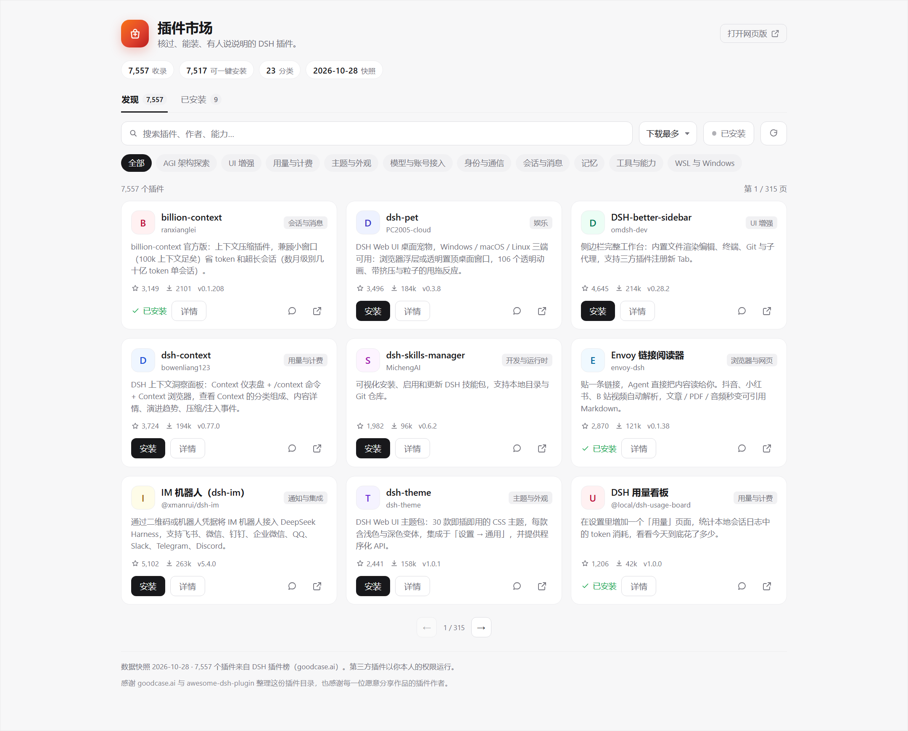
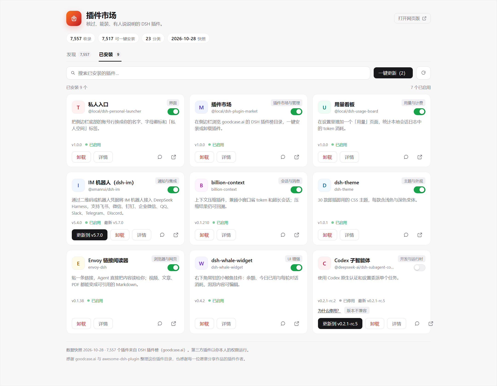
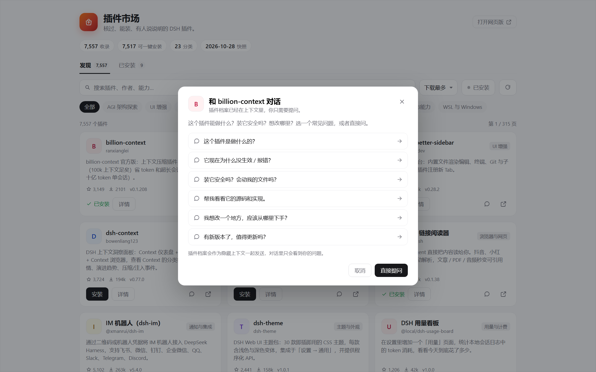

# DSH 插件市场 / DSH Plugin Market

[中文](#zh) · [English](#en)

把 DSH 插件榜放进侧边栏。7,557 个插件，装、更新、关掉，都不用离开 Harness。

The DSH plugin catalog, inside your sidebar. 7,557 plugins. Install, update, and remove them without leaving Harness.

## 界面 / Screens



*图 1：发现页。截图使用样例数据。 / Figure 1: Discover. Sample data.*



*图 2：已安装页，带开关、更新和停用原因。 / Figure 2: Installed, with switches, updates, and disabled reasons.*



*图 3：插件对话，六个常见问题。 / Figure 3: Plugin chat with six common questions.*

<a id="zh"></a>

## 中文

### 为什么会有这个

我用 DSH 的第一周，装插件要这么走一遍：在网页榜单里找到名字，复制安装命令，切回终端，粘贴，等 pnpm 跑完，重启 DSH，再回网页确认它到底装上没有。

插件少的时候还行。后来榜单越来越长，这个流程就有点烦。手机应用商店点一下就能装，DSH 里为什么不能？

Harness 本身有 `pluginManager`，装 bundle 的能力已经在了，缺的是一个能看见目录、点了就装的界面。我把 goodcase.ai 上的 7,557 条目录抓成静态快照，做成侧边栏里的面板。它调用 Harness 的接口装真实 bundle，装完就能用。

### 现在能做什么

- 7,557 个插件，23 个分类。可以按名称、作者、能力搜，也可以按下载量、Star 或收录时间排序。
- 安装、卸载、启用、停用都走 Harness 自己的插件管理接口。安装任务放在 Host，切走页面不会中断，回来还能接上进度。
- 已安装页会列全 profile 里的 bundle，包括本地 link、目录里没有的插件。每个插件有开关；停用的会说明原因，版本不兼容的可以直接更新修复。
- 有多个插件可更新时，已安装页会给出「一键更新（n）」，按队列逐个装。
- 每张插件卡片都有一个对话入口。六个常见问题点一下就会带着插件档案开聊，档案在模型上下文里，聊天记录里看不到。

### 安装

Release 包是固定版本，装起来最省事：

```bash
dsh plugin --profile <profile> add https://github.com/skystart233-code/dsh-plugin-market/releases/download/v1.0.0/local-dsh-plugin-market-1.0.0.tgz
```

想跟 `main` 的最新改动：

```bash
dsh plugin --profile <profile> add github:skystart233-code/dsh-plugin-market
```

本地开发就 clone 下来，在 profile 的 `package.json` 里 link，并把同名 key 加进 `dsh.profile.bundles`：

```json
"@local/dsh-plugin-market": "link:C:/path/to/dsh-plugin-market"
```

装好后重启 DSH。侧边栏的「插件」和「自动化任务」之间会多一个店铺袋图标，线条和旁边那几个导航图标是一套。

包名是 `@local/dsh-plugin-market`，因为我的 desktop profile 直接 link 了这个目录。npm 上的 `dsh-plugin-market` 已经被占用，所以暂时没有 npm 包。GitHub 和 Release 都能装。

### 几个实现上的选择

进度条是估算的。`pluginManager.installBundle` 只在结束时返回结果，拿不到 pnpm 的实时输出。面板按耗时把进度推到 95%，完成时跳到结束；阶段文案也按同一套时间走。这比让按钮一直转圈强，但别把它当成精确进度。

安装任务放在 Host 的 jobs 里，不跟着面板走。切到别的会话、刷新页面，任务还在。重新进入市场时，面板调用 `jobs`：运行中的接管，已完成的弹一次提示，等待构建脚本批准的重新打开批准框。完成提示用 localStorage 去重。

版本比较用 semver。目录是 10 月 28 日的快照，可能比本地版本旧；只有市场版本严格更高时才显示更新，避免把新版本“更新”成旧版本。

停用原因来自运行时。手动关闭、版本不兼容、加载错误、随 DSH 安装自带的内置 bundle，面板分开显示；不兼容的会从 `installTarget` 里拿对应版本，给出更新按钮。

对话的插件档案没有放进输入框。Host 创建会话后，把档案注册到 `agent.ctx` 的 system prompt（名字 `plugin-market-brief`，order 950，`interpolate: false`），再把问题作为普通用户消息发进去。所以聊天记录里只有问题和回答。

### 数据

`catalog.json` 是 2026-10-28 的快照，来自 [dsh.goodcase.ai](https://dsh.goodcase.ai/)，底层是 [awesome-dsh-plugin](https://github.com/billLiao/awesome-dsh-plugin)。7,557 条里 7,517 条声明了 `dsh` manifest，可以点一下安装；其余 40 条保留手动命令。

面板里的名称、作者、分类、双语描述、npm 包名和版本、Star、下载量、仓库、安装命令都来自这份快照。已安装、启用、加载错误来自当前 profile 的 `pluginManager.listBundles()`。有没有更新，是快照版本和运行时版本做 semver 比较的结果。

重新生成目录：

```bash
node scripts/build-catalog.mjs
node scripts/build-catalog.mjs --chunk <saved-turbopack-chunk>
```

### 它是怎么搭的

`index.js` 是 Host 半边，在 Harness Web 服务上挂 `POST /api/dsh-market/*`。路由有 `bootstrap`、`search`、`installed`、`install`、`jobs`、`poll`、`cancel`、`set-enabled`、`chat`、`remove`。安装走 `installBundle`，卸载走 `removeBundle`，启停走 `setBundleEnabled`。耗时任务放进 jobs，客户端轮询，不让一个 HTTP 请求挂几分钟。

`client.js` 是 Client 半边，注册侧边栏图标和主面板，负责搜索、筛选、分页、弹层、进度、开关和对话入口。样式全部走 `--dsw-alias-*` token，深浅色主题自动跟。

`catalog.json` 是静态目录，面板离线也能打开。没有构建步骤，两个半边都是普通 JavaScript。

```text
dsh-plugin-market/
├─ index.js              Host 半边 + 路由 + 安装任务
├─ client.js             Client 半边 + 样式 + 交互
├─ catalog.json          7,557 条目录快照
├─ cordis.patch.yml      bundle 声明
├─ scripts/
│  └─ build-catalog.mjs  从线上站点重建目录
├─ tools/
│  └─ preview.mjs        渲染 README 预览图
├─ test/
│  └─ market.test.mjs    Host 测试
└─ docs/                 README 图片
```

### 安全

第三方插件以你的权限运行。目录收录不等于安全审计，详情页和构建批准框里都会写这句话。

安装时如果 pnpm 发现构建脚本，面板会先列出脚本，点「允许并继续」才会执行。安装接口只接受同源 POST，不是本机页面发起的请求会被拒绝。

这个面板本身也是普通 bundle，不能绕过 `pluginManager` 的权限。这个项目和 DeepSeek 没有隶属关系。

### 限制

- 目录是静态快照。新插件要重新生成 `catalog.json` 才会出现，面板不会每次打开都去抓几 MB 的线上数据。
- 进度是估算，原因上面说了。
- 同一时间只跑一个安装。批量更新是顺序队列，避免 pnpm 并发写同一个 profile。
- 不能在页面里卸载插件市场自己。这个按钮会禁用，免得自己把自己拆掉。
- 预览图是 `tools/preview.mjs` 用样例数据渲染的，不是自动化视觉测试。

### 开发

```bash
node --test test/market.test.mjs
node --check index.js
node --check client.js
node tools/preview.mjs --shot
```

18 项 Host 测试。改完重载 bundle 就能看到效果，没有编译步骤。

### 致谢

目录数据来自 [dsh.goodcase.ai](https://dsh.goodcase.ai/)（DSH 插件榜），它建立在 [awesome-dsh-plugin](https://github.com/billLiao/awesome-dsh-plugin) 上。谢谢维护者把这些信息整理成公开、可检索的列表。

也谢谢每一位把作品放进目录的插件作者。这个面板只是索引，具体功能都在插件里。

DeepSeek Harness 提供了插件运行时、Web slot 和主题 token，这个面板才能长得像原生界面。面板底部另有一句对目录整理者的致谢。

<a id="en"></a>

## English

### Why this exists

The first week I used DSH, installing a plugin went like this: find the name on a web list, copy the install command, switch to a terminal, paste it, wait for pnpm, restart DSH, then go back to the web page and check whether it actually worked.

That was fine with a handful of plugins. As the list grew, the loop got old. Phone app stores solved this a long time ago: search, tap install, watch it finish, remove it when you stop using it. I wanted the same thing inside DSH.

Harness already had `pluginManager`, so the missing part was an interface that shows the catalog and installs from it. I took the 7,557-entry catalog from goodcase.ai, saved it as a static snapshot, and built this sidebar panel. It installs real bundles through the Harness API.

### What it does

- 7,557 plugins across 23 categories. Search by name, author, or capability; sort by downloads, stars, or when the entry was added.
- Install, remove, enable, and disable through Harness's own plugin manager. Installs run on the Host, so leaving the page doesn't cancel them.
- The Installed tab includes every bundle in the profile, including local links the catalog doesn't know about. Each one has a switch; disabled entries explain why, and version mismatches offer the update that fixes them.
- When several plugins have updates, the Installed tab offers **一键更新（n）** (Update all) and runs them as a queue.
- Every card has a chat button. Six common questions open a conversation with the plugin brief already in context; the transcript only shows your question and the answer.

### Install

The release tarball is the stable route:

```bash
dsh plugin --profile <profile> add https://github.com/skystart233-code/dsh-plugin-market/releases/download/v1.0.0/local-dsh-plugin-market-1.0.0.tgz
```

To follow `main`:

```bash
dsh plugin --profile <profile> add github:skystart233-code/dsh-plugin-market
```

For local development, clone the repo and link it in the profile's `package.json`, then add the same key to `dsh.profile.bundles`:

```json
"@local/dsh-plugin-market": "link:C:/path/to/dsh-plugin-market"
```

Restart DSH when it's done. A storefront icon shows up between the **插件** and **自动化任务** entries in the sidebar, drawn in the same line style as the shipped nav icons.

The package is named `@local/dsh-plugin-market` because my desktop profile links this checkout directly. The npm name `dsh-plugin-market` is already taken, so there is no npm package yet. GitHub and the release both work.

### Some choices

The progress bar is an estimate. `pluginManager.installBundle` only returns the final result, and pnpm's live output never reaches the panel. The bar eases toward 95% based on elapsed time and jumps to done when the Host reports the result; the phase labels follow the same clock. It beats a spinner that says nothing, but it is not a byte counter.

Install jobs live in the Host, not in the panel. Switch sessions or reload the page and the job keeps running. On re-entry the panel calls `jobs`: a running job is adopted, a finished one produces a single toast, and a job waiting for build-script approval reopens the approval sheet. Finished jobs are announced once per browser via localStorage.

Updates use semver precedence. The catalog is a snapshot from October 28 and can be older than what is installed; the panel only offers an update when the catalog version is strictly higher, so a stale snapshot cannot downgrade a newer local build.

Disabled reasons come from the runtime. Manual disable, version mismatch, load error, and a bundle that ships with DSH are shown separately. For a mismatch, the panel reads the matching version from `installTarget` and offers the update that fixes it.

The chat brief never goes into the composer. The Host creates a session, registers the brief on `agent.ctx` as a system prompt (`plugin-market-brief`, order 950, `interpolate: false`), then sends the question as a normal user message. The transcript shows the question and the answer, nothing else.

### Data

`catalog.json` is a 2026-10-28 snapshot from [dsh.goodcase.ai](https://dsh.goodcase.ai/), which is built on [awesome-dsh-plugin](https://github.com/billLiao/awesome-dsh-plugin). Of the 7,557 entries, 7,517 declare a `dsh` manifest and can be installed from the panel; the other 40 keep a manual command.

Names, authors, categories, bilingual descriptions, npm package names and versions, stars, downloads, repositories, and install commands come from that snapshot. Installed/enabled/error state comes from `pluginManager.listBundles()` in the current profile. Update availability is a semver comparison between the snapshot version and the runtime version.

Rebuild the catalog with:

```bash
node scripts/build-catalog.mjs
node scripts/build-catalog.mjs --chunk <saved-turbopack-chunk>
```

### How it fits together

`index.js` is the Host half. It serves `POST /api/dsh-market/*` on the Harness web server: `bootstrap`, `search`, `installed`, `install`, `jobs`, `poll`, `cancel`, `set-enabled`, `chat`, and `remove`. Installs call `installBundle`, removals call `removeBundle`, and enable/disable calls `setBundleEnabled`. Long operations go into the jobs map, and the client polls instead of holding an HTTP request open.

`client.js` is the Client half. It registers the sidebar icon and the main panel, then handles search, filtering, pagination, dialogs, progress, switches, and the chat entry. Every color comes from a `--dsw-alias-*` token, so light and dark themes follow the shell.

`catalog.json` is static, which is why the panel opens offline. There is no build step; both halves are plain JavaScript.

```text
dsh-plugin-market/
├─ index.js              Host half: routes and install jobs
├─ client.js             Client half: styles and interaction
├─ catalog.json          7,557-entry snapshot
├─ cordis.patch.yml      bundle declaration
├─ scripts/
│  └─ build-catalog.mjs  rebuild the catalog from the live site
├─ tools/
│  └─ preview.mjs        render the README screenshots
├─ test/
│  └─ market.test.mjs    Host tests
└─ docs/                 README images
```

### Security

Third-party plugins run with your permissions. A catalog listing is not a security review; the detail sheet and the build-approval dialog both say so.

If pnpm finds build scripts during an install, the panel lists them first and waits for **允许并继续**. The install endpoint accepts same-origin POST only, so requests from another local page are rejected.

The panel is a normal bundle. It cannot bypass `pluginManager` permissions, and the project has no affiliation with DeepSeek.

### Limits

- The catalog is static. New plugins need a rebuilt `catalog.json`; the panel doesn't download several megabytes on every open.
- Progress is estimated, as described above.
- One install runs at a time. Batch updates are sequential so pnpm never writes the same profile concurrently.
- The market cannot uninstall itself from its own page. That button is disabled.
- The screenshots are rendered by `tools/preview.mjs` with sample data. They are not an automated visual test.

### Development

```bash
node --test test/market.test.mjs
node --check index.js
node --check client.js
node tools/preview.mjs --shot
```

18 Host tests. Reload the bundle after a change; there is no compile step.

### Thanks

The catalog comes from [dsh.goodcase.ai](https://dsh.goodcase.ai/) (the DSH plugin list), which is built on [awesome-dsh-plugin](https://github.com/billLiao/awesome-dsh-plugin). Thanks to the maintainers for keeping that information public and searchable.

Thanks to every plugin author who put their work in the catalog. This panel only indexes the catalog; the features live in the plugins.

DeepSeek Harness provides the plugin runtime, web slots, and theme tokens that let a third-party panel look native. The panel footer thanks the catalog maintainers separately.

## License

[MIT](LICENSE) © 2026 TKK
